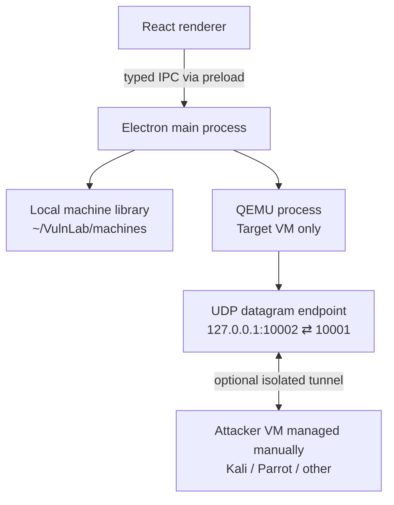

# Architecture

VulnLab Manager is a local Electron application with a React renderer and a privileged Electron main process.

## Main process responsibilities

- Detect QEMU tools and host platform/architecture.
- Import archives, OVF/VirtualBox metadata folders, and disk images.
- Reject unsafe archive paths and symbolic links during extraction.
- Store machine metadata in the per-user application data directory.
- Create a disposable QCOW2 write overlay for each run.
- Launch one QEMU target at a time and record process output.
- Stop only the QEMU process started by this app.
- Reveal the optional generic Linux network setup files; it never transfers or runs them in a guest.

## Renderer responsibilities

- Display host tool availability, imported machines, selected machine configuration, and activity logs.
- Invoke typed IPC methods through the isolated preload bridge.
- Does not access Node APIs or spawn processes directly.

## Platform abstraction

The application uses platform-specific QEMU display backends (Cocoa on macOS, SDL on Windows, GTK on Linux), resolves QEMU executables from PATH and common installation locations, and uses the platform's archive utility for tar entry inspection. Package outputs are generated separately for macOS ARM64 and Windows ARM64.

## Deliberate scope

The application manages target machines launched by QEMU. Attacker machines and third-party hypervisors remain under direct user control. The optional UDP network connection is a transport pairing, not an automatic configuration of the attacker VM.
